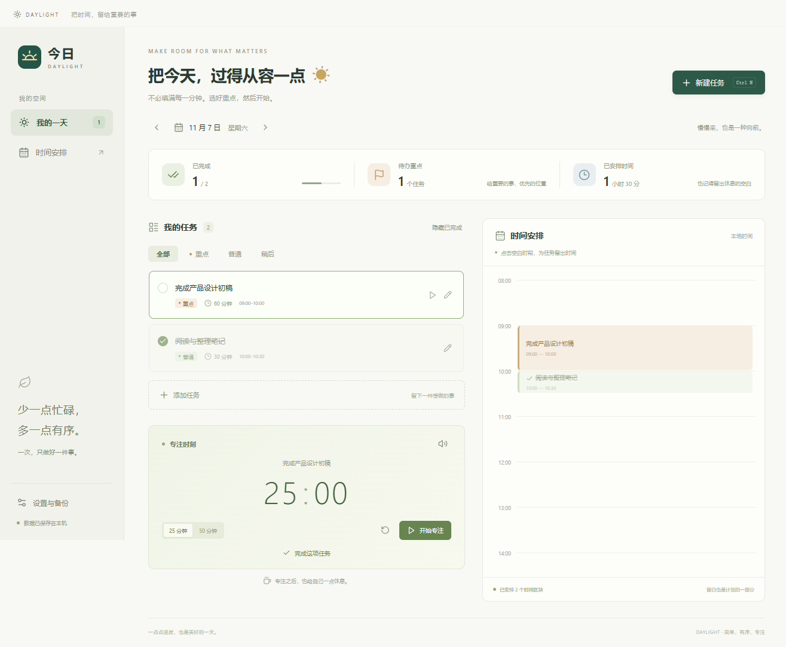

# 今日 · Daylight

一个让一天变得简单、有序的个人任务桌面应用。选出重点，为任务留出时间，一次专注一件事。



## 下载使用

在 [Releases](../../releases) 下载 `Daylight-0.1.0-Windows-x64.exe`，双击运行，无需安装或注册。支持 Windows 10 / 11 x64。

这是尚未签名的早期版本，Windows 可能提示“未知发布者”。仅运行来自本仓库 Release 的文件；Release 同时附带 SHA-256 校验值。

## 功能

- 任务新增、编辑、删除、完成与恢复，重点 / 普通 / 稍后三档优先级。
- 按日期管理任务，切换前后日期，快速返回今天。
- 设置任务时长与开始时间，自动呈现时间区块；创建和编辑时阻止时间冲突。
- 25 / 50 分钟专注计时，支持暂停、继续、重置和可关闭的结束提示音。可关联任务并直接完成。
- 统计当天完成量、待办重点与已安排时长。
- 本地 JSON 持久化、自动保留上一次有效数据备份，支持手动导出与导入。
- `Ctrl+N` 新建任务，`Esc` 关闭弹窗；支持键盘操作和弹窗焦点约束。

首版不包含账号、云同步、自动更新或循环任务。专注计时在退出应用后重置；任务及时间安排会保留。时间区块通过表单调整，暂不支持拖拽。

## 本地开发

需要 Node.js 22.12+、npm 和 Windows 10 / 11。首次安装会下载 Electron 运行时，需要访问 npm 和 GitHub。

```sh
npm ci
npm run dev
```

```sh
npm test            # 数据校验、日期与时间冲突测试
npm run test:e2e    # 真正启动 Electron，检查主要交互与重启持久化
npm run dist        # 生成 Windows x64 免安装可执行文件
```

产物位于 `release/`。也可以 `npm run build` 后 `npm start` 直接运行。

## 数据与隐私

应用不含遥测或远程服务。任务写入 Electron 的 `userData` 目录；Windows 默认位置为 `%APPDATA%/daylight-desktop/daylight.json`。数据以明文存储，未加密，请妥善保管电脑和导出的备份。

保存通过临时文件与重命名完成，同时保留 `daylight.json.bak`。主文件损坏时尝试恢复上一份有效备份；导入文件会校验格式，并在替换前二次确认。导入的历史时间块按原样保留。

免安装版的任务保存在 Windows 用户目录，移动 EXE 不会同时移动数据。换电脑前，请从“设置与备份”导出，再到新电脑导入。

## 技术与项目结构

Electron + React + Vite，所有 UI 资源随应用打包，离线可用。渲染进程使用沙箱、上下文隔离和受限 preload API；不开放 Node.js、不加载远程页面。主进程负责数据校验和文件操作。

```text
electron/       窗口、IPC 与本地文件存储
shared/         数据校验、日期和时间块规则
src/            React 界面与样式
tests/          单元测试与 Electron 桌面交互测试
.github/        Windows 自动构建工作流
```

MIT License。
